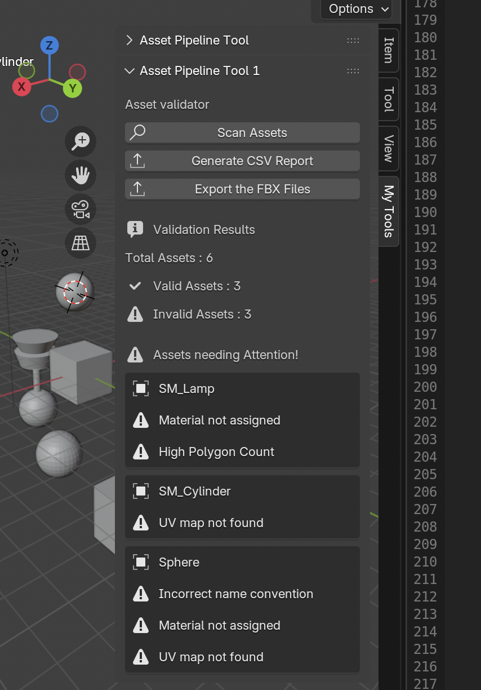
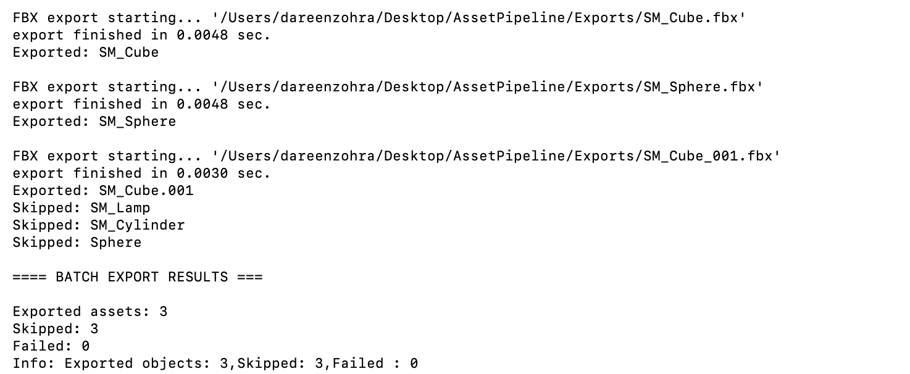
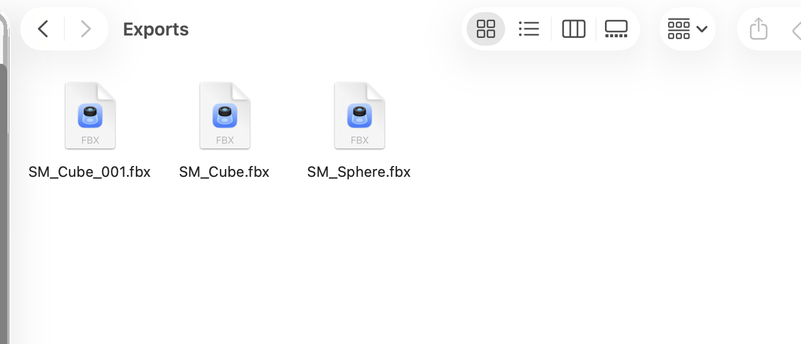

# Blender Asset Pipeline Tool

A Python-based Blender add-on designed to automate 3D asset validation, generate CSV reports, and batch-export game-ready assets as FBX files.

This project is part of my journey towards becoming a **Technical Artist**, with a focus on pipeline development, tools programming, and 3D asset workflows.

## Project Overview

Preparing 3D assets for game engines involves several repetitive tasks, such as checking naming conventions, verifying materials, inspecting UV maps, and exporting assets.

The Blender Asset Pipeline Tool aims to simplify these tasks by providing an automated validation and export workflow directly inside Blender.

## Features

### 1. Automated Asset Validation

The tool checks mesh objects for:

- **Naming conventions:** Verifies whether object names follow the `SM_` prefix convention.
- **Material assignment:** Checks whether materials are assigned.
- **UV maps:** Checks whether UV maps are available.
- **Triangle count:** Calculates the number of triangles in each mesh.
- **High polygon warning:** Identifies objects containing more than 1,000 polygons.

### 2. Blender User Interface

- Custom Blender add-on panel.
- Interactive buttons for asset scanning and CSV report generation.
- Displays validation summaries.
- Identifies assets that require attention and displays their issues.

### 3. CSV Report Generation

Generates structured CSV reports containing:

- Object names
- Vertex, edge, face, and triangle counts
- Material and UV map status
- Validation status
- Detected issues and warnings

### 4. Batch FBX Export

- Exports valid mesh assets individually.
- Skips assets that fail validation.
- Uses Blender's FBX export functionality.
- Tracks successful, skipped, and failed exports.
- Handles individual export errors using Python exception handling.

## Technologies Used

- **Python**
- **Blender 4.5**
- **Blender Python API (`bpy`)**
- **CSV module**
- **OS module**
- **FBX Export**

## Project Structure

```text
Blender-Asset-Pipeline-Tool/
│
├── addon/
│   └── Asset_validator_csv_and_fbx_exporter.py
│
├── screenshots/
│   ├── validator_panel.png
│   ├── validation_results.png
│   └── batch_export.png
│
├── reports/
│   └── AssetValidator2.csv
│
└── README.md
```

## Installation and Usage

1. Download or clone this repository.
2. Open Blender 4.5.
3. Navigate to the Scripting workspace.
4. Open the `Asset_validator_csv_and_fbx_exporter.py` script.
5. Run the script to register the add-on.
6. Open the 3D Viewport sidebar by pressing `N`.
7. Navigate to the **My Tools** tab.
8. Use the Asset Pipeline Tool panel to scan assets, generate reports, and export valid assets.

## Screenshots

### Asset Validator Interface



### Validation Results



### Batch FBX Export



## Learning Outcomes

Through this project, I have gained practical experience with:

- Blender Python API and scripting.
- Python functions, dictionaries, and file handling.
- Developing custom Blender operators and UI panels.
- Automating 3D asset validation.
- Generating structured CSV reports.
- Batch FBX exporting.
- Error handling and exception management.

## Project Status

**Currently in development.**

Future improvements will focus on expanding the asset pipeline, improving automation, and integrating Blender workflows with Unreal Engine.

## Author

**Technical Artist Portfolio Project**

Developed as part of my learning journey in Technical Art, focusing on Pipeline & Tools Development and Performance Optimization.

